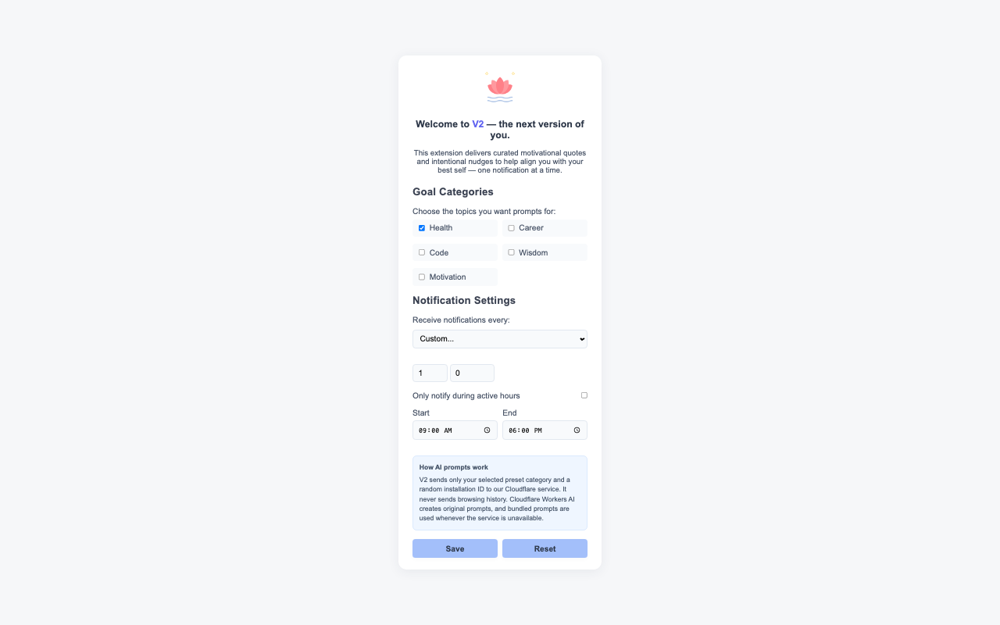

# V2 — Your Self-Improvement Companion

*Small reminders for the person you're becoming.*

V2 is a Chrome extension that delivers gentle prompts throughout your day. Choose a category, set a reminder interval, and make space for a moment of reflection—whether you're working, studying, coding, or taking a break.

[View V2 in the Chrome Web Store](https://chromewebstore.google.com/detail/igonfkldenaeailncliahdblmcmnnoci) · [Privacy policy](PRIVACY.md) · [Prompt quality policy](worker/QUALITY_POLICY.md)



## What it does

- **Five categories:** Health, Career, Code, Wisdom, and Motivation.
- **Flexible reminders:** Choose a preset interval or set your own.
- **Active hours:** Limit notifications to the times that work for you.
- **Deep Work mode:** Pause reminders temporarily when you need to focus.
- **Offline fallback:** Use bundled prompts when the online service is unavailable.
- **Local settings:** Save preferences and recently shown prompt identifiers in Chrome's local storage.

V2 includes AI-generated prompts. Prompts are served from a shared cache; a reminder does not call an AI model. Each installation tracks the prompts it has seen within a batch to reduce repetition.

## How it works

The extension schedules reminders using Chrome alarms and displays them with Chrome notifications. For each reminder it requests a prompt from a Cloudflare Worker. If that request fails, it selects a bundled local prompt instead.

An administrator can refresh a category's shared batch through a protected endpoint:

1. Cloudflare Workers AI generates candidate prompts.
2. Rules check format, length, duplicates, attribution, and certain unsafe language.
3. Candidates are stored in a separate staging namespace. GPT-5.4 evaluates them for relevance, usefulness, clarity, tone, safety, and originality.
4. Passing prompts are retained and rejected prompts can be replaced, within a limited number of attempts. A batch is promoted to the shared cache only when all required prompts pass.

The current configuration uses batches of 20 and manual administrator-triggered refreshes. AI checks reduce risk but cannot guarantee every prompt is appropriate or original. See the [quality policy](worker/QUALITY_POLICY.md) for the criteria and limitations. Existing cache entries may predate the current evaluation workflow.

## Version history

### 1.1.1

- Maps the previous **Motivational** category to **Motivation** when migrating version 1.0 settings.
- Asks affected users to review their settings when their previous category is unavailable or they had hidden notification previews. Reminders remain paused until they save their choices.
- Fixes an issue that could re-enable Health when another category was selected.

The review notice applies when version 1.0 settings are first migrated. It does not automatically restore choices already changed by an earlier 1.1.0 migration.

### 1.1.0

- Added five preset categories, active hours, and timed Deep Work pauses.
- Added shared cached AI-generated prompts and bundled fallback prompts.
- Updated the settings and popup interfaces.

### 1.0

- Introduced motivational reminders, category selection, custom intervals, and Do Not Disturb.

## Technology

- **Extension:** JavaScript, HTML, CSS, and Chrome's Manifest V3 APIs.
- **Backend:** Cloudflare Workers and Workers KV.
- **Generation and evaluation:** Cloudflare Workers AI and OpenAI's GPT-5.4 API.

## Run locally

1. Clone this repository:

   ```bash
   git clone https://github.com/naisydaze/Ver2_Chrome_Extension.git
   cd Ver2_Chrome_Extension
   ```

2. Open `chrome://extensions` in Chrome and turn on **Developer mode**.
3. Click **Load unpacked** and select the repository folder.
4. Open V2's settings, choose a category and interval, and allow Chrome notifications if prompted.

An unpacked extension can have a different ID from the published extension. The configured Worker accepts only its allowed extension origins, so a different local ID may use bundled fallback prompts unless the Worker configuration is updated.

## Develop the Worker

The repository's Worker configuration points to V2's existing Cloudflare resources. To deploy your own instance, create separate `QUOTE_CACHE` and `QUOTE_STAGING` KV namespaces in your Cloudflare account and replace their IDs in `worker/wrangler.jsonc`. Configure the allowed extension origin, the Worker URL in `src/utils/quoteClient.js`, and the corresponding host permission in `manifest.json` for your deployment.

From the `worker` directory, install dependencies and authenticate Wrangler:

```bash
cd worker
npm install
npx wrangler login
```

Set `ADMIN_TOKEN` for protected maintenance requests and `OPENAI_API_KEY` for evaluation as Worker secrets. Never put either secret in the extension or commit it to Git. GPT-5.4 evaluation uses the paid OpenAI API, separately from Cloudflare Workers AI.

```bash
npx wrangler secret put ADMIN_TOKEN
npx wrangler secret put OPENAI_API_KEY
npm run deploy
```

Generate a category batch from a trusted terminal, with `V2_ADMIN_TOKEN` set to the same value as `ADMIN_TOKEN`:

```bash
curl "https://YOUR-WORKER.YOUR-SUBDOMAIN.workers.dev/admin/generate" \
  -X POST \
  -H "Authorization: Bearer $V2_ADMIN_TOKEN" \
  -H "Content-Type: application/json" \
  -d '{"category":"health"}'
```

Inspect the latest staged result through the protected endpoint:

```bash
curl "https://YOUR-WORKER.YOUR-SUBDOMAIN.workers.dev/admin/staging?category=health" \
  -H "Authorization: Bearer $V2_ADMIN_TOKEN"
```

Run the automated tests from `worker`:

```bash
npm test
```

To create a clean Chrome Web Store package from the repository root:

```bash
./scripts/build-extension.sh
```

The resulting package is `dist/v2-extension-1.1.1.zip`.

## Privacy

V2 does not read browsing history or page contents. The extension sends the selected category, a random installation identifier, and recently shown prompt identifiers to the Worker when requesting a cached prompt. During administrator-triggered quality checks, generated candidate prompts and their category are sent to OpenAI. See the [privacy policy](PRIVACY.md) for details.
